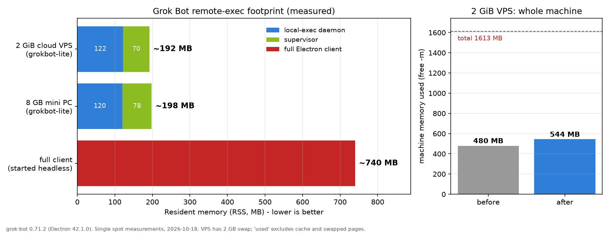

# grokbot-lite

[](https://github.com/h1neolzr7f/grokbot-lite/actions/workflows/ci.yml)
[](LICENSE)


**让 Grok Bot 能在没有图形界面的 Linux 服务器上跑起来——同时做到轻量化。**

官方客户端是桌面应用；无显示器的云服务器上完整客户端要么起不来，要么硬开无界面还要 Xvfb、吃掉约 740 MB。
**grokbot-lite** 给出一套可工作的无桌面运行方式（专用用户 + systemd + 只改 1 字节的 RunAsNode），远程执行后台合计约 **190 MB**，不需要桌面、不需要 Xvfb、不用 root 跑。几十块钱一年的 1–2 GB VPS 就能当 24 小时远程开发机。

> ⚠️ **非官方项目**：与 xAI / Grok Bot 官方无关。它会修改官方二进制里的一个 Electron fuse（RunAsNode），**风险自负**；改之前会自动备份，可一键还原。

[English](README.en.md) · [新手教程：从买服务器到连上](docs/beginner-guide.md) · [新手 FAQ](docs/faq.md) · [内存基准](docs/benchmark.md) · [安全设计](docs/security.md) · [适用场景](docs/use-cases.md) · [原理](docs/how-it-works.md) · [兼容性](compat/README.md)

## 🚀 VPS 一键安装

在一台全新的 **Ubuntu 24.04 / 22.04 或 Debian 12** 云服务器（阿里云/腾讯云轻量、任何 KVM VPS）上，用 root 或 sudo 运行：

```bash
curl -fsSL https://raw.githubusercontent.com/h1neolzr7f/grokbot-lite/main/install.sh | sudo bash
```

> 想先看脚本内容：把 `| sudo bash` 换成 `-o install.sh`，看完再 `sudo bash install.sh`。

脚本会用中文一步步提示，只问几个是/否问题（直接回车就是安全的默认选项），然后自动完成：

1. 检查系统、架构、内存、磁盘、systemd（不满足时告诉你怎么办）
2. 内存小且没有 swap 时，建议创建 2 GB swap
3. 添加官方 apt 源，安装 `grok-bot`（`--no-install-recommends`，约 350 MB）
4. 系统 Node 太旧（如 Ubuntu 24.04 自带 v18）时，把 Node 22 装到 `/opt/node22`，**不动系统 Node**，并校验 sha256
5. 创建专用用户 `grokbot`（非 root、没有 sudo），开启 linger（开机自动启动）
6. **先备份**官方二进制，再**只改 1 个字节**打开 RunAsNode 开关
7. 安装监督进程 [grokbot-headless](https://github.com/andreanjos/grokbot-headless)（固定版本），通过 `check --local` 自检
8. 在醒目的框里显示**一次性登录链接 + 终端二维码 + 倒计时**，等你在浏览器里登录
9. 策略设为 `ask`（每条远程命令都要你批准），启动服务，体检，显示绿色成功总结和内存占用

| 场景 | 命令 |
| --- | --- |
| 全自动（默认选项） | `curl -fsSL …/install.sh \| sudo bash -s -- --yes` |
| 登录错了账号 / 换账号 | `curl -fsSL …/install.sh \| sudo bash -s -- --switch-account` |
| 卸载并恢复官方原版 | `curl -fsSL …/install.sh \| sudo bash -s -- --uninstall` |
| 出问题看日志 | `sudo tail -n 50 /var/log/grokbot-lite-install.log` |

脚本可以**重复运行**：已完成的步骤会自动跳过，中途失败修好后再跑一次即可。

## 测试情况（请先看）

| ✅ 已实测 | ⚠️ 尚未测试 |
| --- | --- |
| Ubuntu 24.04 x86_64，2 GiB 云服务器（阿里云轻量）| `install.sh` 在全新机器上**从头到尾**完整跑一遍 |
| Ubuntu 24.04 x86_64，8 GB 小主机 | arm64 |
| grok-bot 0.71.2（Electron 42.1.0）| Debian 12、Ubuntu 22.04 |
| `doctor` / `status --json` / `read-fuse` / fuse 补丁（只改 1 字节）| 1 GB 内存机器（文档中的 1 GB 数据为估算）|

VPS 是按同样流程手工搭建的，一键脚本的每一步都有自动化测试（全 mock），但还没在真机上整体跑过。
**欢迎反馈兼容性**：跑完后用 `sh compat/detect.sh --yaml` 生成报告，通过 [Compatibility report](https://github.com/h1neolzr7f/grokbot-lite/issues/new?template=compat_report.yml) 提交（成功、失败都有用）。

## 为什么需要它

- **核心问题：Grok Bot 官方客户端依赖图形桌面**，在无桌面的 Linux 服务器上无法直接使用。
- 硬开完整客户端的无界面模式要 **~740 MB** 还要 Xvfb，1–2 GB 的机器基本吃不消。
- 社区方案 grokbot-headless 能无窗口启动，但官方从 **0.71.2** 起关闭了 Electron 的 RunAsNode 开关，该方案直接崩溃。
- **grokbot-lite** 给出完整的无桌面运行方式：只把这一个开关改回来（先备份、可一键还原），再打包成云服务器一键安装；顺带把内存压到约 190 MB，升级被重置时还会提醒你。

**目前没有其他现成方案能在无图形界面的 Linux 云服务器（尤其是 1–2 GB）上跑 Grok Bot 远程执行。**

## 对比

| | 完整客户端无界面启动 | **grokbot-lite** |
| --- | --- | --- |
| 内存（实测） | ~740 MB，且启动后是未登录状态 | **~190 MB**（2 GiB VPS）/ ~200 MB（小主机） |
| 显示服务器 | 需要 Xvfb 或桌面 | **不需要** |
| 运行身份 | 通常是你的主账号 | **专用非 root 用户，无 sudo** |
| 开机自启 | 自己折腾 | systemd 用户服务 + linger |
| 官方升级后 | 静默失效 | 定时体检 + apt 提醒 + `fix` 一键修复 |

| | 只在桌面电脑上用 Grok Bot | **VPS + grokbot-lite** |
| --- | --- | --- |
| 在线时间 | 电脑开着才行 | **7×24 小时** |
| 成本 | 你的电脑一直开机 | 几十元/年起的轻量服务器（价格以云厂商活动为准） |
| 公网 IP / 带宽 | 家宽、常无公网 IP | 自带公网 IP，适合托管测试服务 |
| 弄坏了怎么办 | 影响你的主力机 | 重装系统，重跑一键脚本 |

## 实测数据

| 机器 | 后台 | 监督进程 | 合计 | 整机 |
| --- | --- | --- | --- | --- |
| 阿里云轻量，2 vCPU / 2 GiB（可见 1613 MB）+ 2 GB swap，Ubuntu 24.04.2 | 122 MB | 70 MB | **~190 MB** | 已用 480 → 544 MB，可用 1068 MB |
| 小主机，8 核 / 7.6 GB，Ubuntu 24.04.5 | 120 MB | 78 MB | **~200 MB** | — |
| 完整客户端无界面启动（小主机） | — | — | ~740 MB | — |



1 GB 机器、4 GB 机器怎么配见 [benchmark.md](docs/benchmark.md)（那部分是**估算**）。

## 日常使用（root 下）

| 命令 | 作用 |
| --- | --- |
| `grokbot-lite doctor` | 体检：开关、备份、服务、后台内存、登录、策略、sudo、linger、定时器（0 正常 / 1 警告 / 2 失败） |
| `grokbot-lite status --json` | 机器可读状态 |
| `grokbot-lite fix --restart` | `apt upgrade` 把开关重置后，一条命令修复（先为新版本备份） |
| `grokbot-lite switch-account` | 退出并重新登录（登录错账号时） |
| `grokbot-lite restore` | 恢复官方原版二进制 |
| `grokbot-lite read-fuse` | 查看 Electron fuse 状态 |

在 root 下运行时，`doctor`/`status`/`switch-account` 会自动切换到服务用户执行（读取 `/etc/grokbot-lite.conf`）。

**在桌面电脑或小主机上、用你自己的账号运行**（不建专用用户）：`./bin/grokbot-lite install --supervisor-src <grokbot-headless 目录>`，详见 [适用场景](docs/use-cases.md)。

## 安全要点

- 服务跑在**专用非 root 用户**下，该用户没有 sudo；`ask` 策略下每条远程命令都要你批准。grokbot-lite **永远不会**设置 `always`，`always` + 免密 sudo 会被 `doctor` 判为失败。
- **不开放任何入站端口**：后台只主动连出（在 VPS 上用 `ss -lntup` 确认它没有 TCP 监听）。不改防火墙、不碰 fail2ban、不改 SSH 配置。
- apt 用 `NEEDRESTART_MODE=l`：只列出需要重启的服务，**不会**擅自重启 docker 等服务。
- 改二进制前备份 + sha256，补丁在副本上做完并校验其他开关不变，再原子替换；一条命令还原。
- 详见 [安全设计](docs/security.md)，包括 RunAsNode 开关的威胁模型。

## 兼容性

| grok-bot | 结论 |
| --- | --- |
| 0.30.0 | 原版即可用（上游验证） |
| 0.71.2 amd64（Electron 42.1.0） | fix 后可用：阿里云轻量 Ubuntu 24.04.2、小主机 Ubuntu 24.04.5 均实测 |
| arm64 / 其他版本 | 未测试，欢迎用 `sh compat/detect.sh --yaml` 提交 |

## 开发

```bash
make lint test        # shellcheck + 58 个 bats 测试（全 mock，不需要真实二进制、root 或网络）
make crosscheck       # 与 @electron/fuses 官方库交叉验证 fuse 解析
make chart            # 重新生成内存图
```

见 [CONTRIBUTING.md](CONTRIBUTING.md)。CI 工作流见 [docs/ci.md](docs/ci.md)（当前以 example 形式提供）。

## 致谢与声明

- 监督进程：[andreanjos/grokbot-headless](https://github.com/andreanjos/grokbot-headless)（MIT）。Fuse 格式参考：[electron/fuses](https://github.com/electron/fuses)。
- 本项目是独立的非官方项目，与 xAI 及 Grok Bot 官方无关，不包含任何专有代码或二进制。它会修改官方二进制中的 Electron fuse，修改官方二进制可能不符合某些使用条款，**风险自负**；软件按 MIT 协议“按原样”提供，不作任何担保。
- 许可证：[MIT](LICENSE)。
